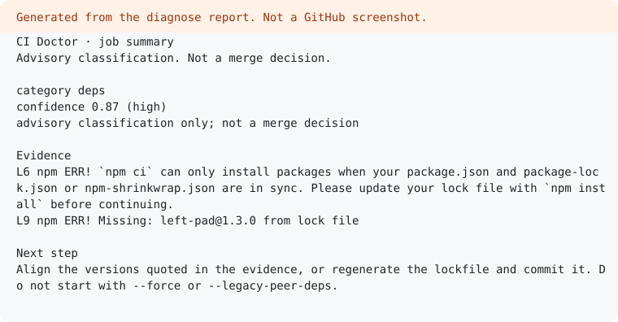

# CI Doctor

[中文](README.zh-CN.md)

CI failed, or GitHub Actions is red? Classify the log, quote redacted evidence, propose one minimal fix, and say how to verify it. Advisory only. Not a merge decision.

## Quick start: add to your workflow

No install step and no LLM. After the workflow named `CI` finishes red, this job downloads that run's logs (`actions: read`) and writes the category to the job summary.

```yaml
name: CI Doctor
"on":
  workflow_run:
    workflows: ["CI"]
    types: [completed]
permissions:
  actions: read
  contents: read
jobs:
  triage:
    if: ${{ github.event.workflow_run.conclusion == 'failure' }}
    runs-on: ubuntu-latest
    steps:
      - uses: haoranyoung09-sys/ci-diagnose@v1
        with:
          run-id: ${{ github.event.workflow_run.id }}
```

Same job, when you already saved the log. `if: failure()` cannot download the current run: the job is still in progress.

```yaml
- uses: haoranyoung09-sys/ci-diagnose@v1
  if: failure()
  with:
    log-path: ci.log
```

`comment` defaults to off. Tradeoffs, permissions, and the `v1` tag: [docs/action.md](docs/action.md).

The pictures below are generated by [`scripts/render_demo.py`](scripts/render_demo.py) from `npm-ci-lockfile-drift`. They are not a recording of github.com.





## 30-second demo

Python 3.9+. No packages, no token, no network.

```bash
git clone https://github.com/haoranyoung09-sys/ci-diagnose.git
cd ci-diagnose
python3 scripts/diagnose.py --fixture npm-ci-lockfile-drift
make eval
```

The fixture command prints a `deps` report for an `npm ci` lockfile drift. `make eval` prints accuracy and a confusion matrix for `fixtures/gha`. It does not call `gh`.

Weekly notes: [docs/PROGRESS.md](docs/PROGRESS.md).

People look for this when a workflow run failed, a check is red, or they want an Actions triage skill. The first host is GitHub Actions. This repository is the skill plus a public synthetic fixture corpus.

The diagnose CLI is a deterministic heuristic, not a model. It is the offline path and the smoke oracle for the fixtures. The skill may disagree when confidence is low; it has to say so.

## Features

<a id="features"></a>

CI Doctor classifies a failed GitHub Actions log, quotes redacted evidence, and names one next step. It does not merge, and it does not decide that a change is safe to land. The GitHub Action in [`action.yml`](action.yml) calls the same classifier. Details: [docs/action.md](docs/action.md).

### What it classifies

Seven ids. A category wins when its score is at least 6 and it leads. A tie at or above 6 is `unknown`. The CLI does not read `meta.json` while it scores.

| id | What it means | A shape you will see in Actions |
| --- | --- | --- |
| `flake` | The result moved, or a transient checkout, registry, or dataset failure | certificate verification failed; external dataset host timed out; a hook that failed only because checkout failed |
| `env` | A named variable, action input, or secret was never set | `DATABASE_URL` is not set |
| `test` | The suite started and an expectation failed | Jest `FAIL`, `AssertionError` |
| `deps` | The resolver or the lockfile disagreed | `npm ci` lockfile drift |
| `permissions` | The token or the registry login was refused | `GITHUB_TOKEN` 403; `pull access denied` |
| `infra` | The runner, its disk, or its network path failed | disk full; MCR `no such host`; Docker daemon down |
| `unknown` | Nothing cleared the threshold, or two categories tied | exit code only; checkout TLS tied with an assertion; egress tied with registry auth |

Definitions and the fixture for each signal: [docs/taxonomy.md](docs/taxonomy.md). The corpus index is [fixtures/README.md](fixtures/README.md).

### How it works

1. Read the log. Stop at 2MB. An empty log stays `unknown`. A signal that sits past the cut is not scored, and the report says `truncated`.
2. Strip `gh` job, step, and timestamp prefixes. Redact common token shapes, then score. Redaction is best-effort.
3. If the log names more than one job and only some of them failed, score the failed jobs. A phrase on a green job does not win (`multi-job-one-step-failed`). If the failed job has no signal, the result stays `unknown` (`multi-job-green-noise-unknown`).
4. Open the playbook for that category and follow one recipe. A tie is not permission to pick the easier side.
5. `make eval` checks every fixture label offline. It does not call `gh`.

### When to use it

- A GitHub Actions job is red and you have the log, a run URL, or a fixture id.
- You want one category, the lines that support it, and one way to verify.
- You are checking the skill against this corpus.

### When not to use it

- To approve a merge, or to say a change is safe to land.
- Dependabot or Renovate version bumps. That sibling is not in this repo.
- GitLab CI, CircleCI, or any host other than GitHub Actions.
- A private log that only makes sense if you paste a secret. Save a redacted file instead.
- The comment workflow. [`.github/workflows/triage-comment.yml`](.github/workflows/triage-comment.yml) is disabled (`if: false`).

### Playbooks and real Actions failures

| What the log shows | Category | Fixture |
| --- | --- | --- |
| Checkout `SSL certificate problem` or `server certificate verification failed` | `flake` | `checkout-tls-verify-flake` |
| That checkout failure, then a hook cannot run | `flake` | `checkout-tls-hook-cascade-flake` |
| A hook cannot run, and the log has no checkout error | `unknown` | `checkout-hook-only-unknown` |
| External dataset host timed out | `flake` | `external-dataset-host-flake` |
| `mcr.microsoft.com` or `ghcr.io`: `no such host`, `egress blocked`, `i/o timeout` | `infra` | `mcr-pull-egress-blocked`, `ghcr-pull-io-timeout` |
| `pull access denied` or `unauthorized: authentication required` | `permissions` | `registry-pull-auth-denied` |
| Egress blocked and registry authentication denied in the same pull | `unknown` | `registry-auth-and-egress-unknown` |
| Several jobs, and only one of them failed | the failed job | `multi-job-one-step-failed` |
| Postgres/Redis service or Helm health check timed out | `flake` | `service-healthcheck-timeout-flake`, `helm-healthcheck-timeout-flake` |
| That health check tied with `AssertionError` | `unknown` | `healthcheck-and-assertion-unknown` |
| External host failed on every recent attempt | `flake` (mirror or vendor; do not rerun the URL twice) | `external-host-chronic-flake` |
| `Gemfile.lock`, `go.sum`, or `Cargo.lock` out of date | `deps` | `bundler-lockfile-out-of-date`, `go-sum-checksum-mismatch`, `cargo-lock-needs-update` |
| `getaddrinfo` / "Temporary failure in name resolution" | `infra` | `dns-name-resolution-infra` |
| `actions/cache` failed to restore, then the lockfile complains | `infra` | `actions-cache-restore-corrupt` |
| Cache `EACCES` and a lockfile line together | `unknown` | `cache-eacces-and-lockfile-unknown` |
| Kernel `Killed` and exit 137, self-hosted runner offline, `Filename too long`, arm64 image on amd64, missing Docker layer | `infra` | `kernel-oom-killed-infra`, `self-hosted-runner-offline-infra`, `windows-filename-too-long-infra`, `runner-arch-mismatch-infra`, `docker-layer-cache-missing-infra` |
| Node `engines` mismatch, missing Python/Node on the image, missing `action.yml` | `env` | `node-engine-mismatch-env`, `setup-python-version-missing-env`, `composite-action-path-missing-env` |
| Bare `toomanyrequests`, Cypress "timed out retrying", Git LFS rate limit | `flake` | `docker-pull-rate-limit-flake`, `cypress-retry-timeout-flake`, `git-lfs-rate-limit-flake` |
| `pnpm-lock.yaml` is not up to date, or the lockfile fails after a `continue-on-error` step | `deps` | `pnpm-lock-not-up-to-date-deps`, `continue-on-error-lockfile-deps` |
| Pull rate limit and `pull access denied` together | `unknown` | `registry-rate-and-auth-unknown` |
| Maven, SwiftPM, CocoaPods, or NuGet could not resolve a package | `deps` | `maven-dependencies-unresolved-deps`, `swiftpm-package-unresolved-deps`, `cocoapods-pod-conflict-deps`, `nuget-package-not-found-deps` |
| Cargo could not reach crates-io; rustc rejected the crate | `flake` / `test` | `cargo-registry-network-flake`, `cargo-type-mismatch-test` |
| Terraform state lock, or no cloud credentials | `flake` / `env` | `terraform-state-lock-flake`, `terraform-credentials-missing-env` |
| kubectl rollout timeout, or RBAC forbidden | `flake` / `permissions` | `kubectl-rollout-timeout-flake`, `kubectl-rbac-forbidden-permissions` |
| GitHub secondary rate limit, or Bad credentials | `flake` / `permissions` | `github-secondary-rate-limit-flake`, `github-bad-credentials-permissions` |
| Java `OutOfMemoryError` or Python `MemoryError` | `infra` | `java-heap-oom-infra`, `python-memory-error-infra` |
| App Store Connect key name missing | `env` | `app-store-connect-key-missing-env` |
| Bazel remote cache down; Nix store hash mismatch; apt mirror 404; Homebrew bottle download; Rust linker OOM | `infra` | `bazel-remote-cache-unavailable-infra`, `nix-nar-hash-mismatch-infra`, `apt-mirror-404-infra`, `homebrew-bottle-download-infra`, `rust-linker-oom-infra` |
| Nix flake output missing; Deno lockfile stale | `deps` | `nix-flake-output-missing-deps`, `deno-lockfile-out-of-date-deps` |
| apt `NO_PUBKEY`, Google ADC missing, Composer PHP too old, reusable workflow secret not passed | `env` | `apt-pubkey-missing-env`, `gcp-adc-missing-env`, `composer-php-platform-env`, `workflow-secret-not-passed-env` |
| AWS rejected the security token | `permissions` | `aws-invalid-token-permissions` |
| Go module proxy 502, or `ECONNRESET` with no assertion | `flake` | `go-proxy-502-flake`, `econnreset-flake` |
| `ECONNRESET` tied with `AssertionError` | `unknown` | `econnreset-and-assertion-unknown` |

Playbooks: [`skills/ci-doctor/references/playbooks/`](skills/ci-doctor/references/playbooks/). Each one has a recipe, a verify step, a stop, and a short 中文 note.

### Offline demo and eval

The [30-second demo](#30-second-demo) is the supported offline path. No packages, no token, no network.

`python3 scripts/diagnose.py --fixture npm-ci-lockfile-drift` prints a `deps` report. `make eval` prints accuracy and a confusion matrix for `fixtures/gha`. `make test` covers empty logs, the 2MB cut, redaction, and ambiguous signals. `make smoke` runs the self-check, the tests, every fixture, and `make eval`.

## Install the skill

The skill source is [`skills/ci-doctor/SKILL.md`](skills/ci-doctor/SKILL.md). This checkout also links it at [`.agents/skills/ci-doctor`](.agents/skills/ci-doctor) so Cursor and Codex discover it from the repo.

| Host | Project path | User path |
| --- | --- | --- |
| Cursor | `.agents/skills/` or `.cursor/skills/` | `~/.agents/skills/` or `~/.cursor/skills/` |
| Codex | `.agents/skills/` | `~/.agents/skills/` |
| Claude Code | `.claude/skills/` | `~/.claude/skills/` |

Cursor also reads `.claude/skills/` and `.codex/skills/`. One install path is enough. To use the skill from another repo, link this directory (do not copy it unless you want a frozen snapshot):

```bash
mkdir -p .agents/skills
ln -sfn /absolute/path/to/ci-doctor/skills/ci-doctor .agents/skills/ci-doctor
```

Claude Code:

```bash
mkdir -p .claude/skills
ln -sfn /absolute/path/to/ci-doctor/skills/ci-doctor .claude/skills/ci-doctor
```

Host details: [docs/hosts.md](docs/hosts.md).

## Diagnose a fixture offline

Python 3.9 or newer. No packages and no token.

```bash
python3 scripts/diagnose.py --fixture npm-test-assertion
python3 scripts/diagnose.py fixtures/gha/npm-test-assertion/log.txt
python3 scripts/diagnose.py --fixtures-dir fixtures/gha
python3 scripts/diagnose.py --self-check
```

`--fixtures-dir` classifies every case under `fixtures/gha`, prints a report (category, confidence, evidence lines, next steps), and exits non-zero if a label does not match `meta.json`. That is the smoke oracle. `make test` runs the stdlib edge-case tests (empty logs, the 2MB cap, redaction, bad fixtures, ambiguous signals, `gh` failure modes). `make eval` scores the same corpus and prints accuracy plus a confusion matrix. It does not call `gh`. `make smoke` runs the self-check, the edge tests, the fixture pass, and `make eval`.

`.github/workflows/triage-comment.yml` is an experimental sketch of a read-only failure comment. The job is disabled (`if: false`), the workflow has `contents: read` only, and it stores no token.

A log larger than 2MB is cut on a newline under that cap before scoring, and the report says `truncated`. The rest of the file is not loaded.

A single fixture looks like this:

```text
ci-doctor 0.1.0
id: npm-test-assertion
log: fixtures/gha/npm-test-assertion/log.txt
category: test
confidence: 0.93 (high)
advisory: classification only; not a merge decision
expected_label: test
label_match: yes
signals: expect(received) mismatch; FAIL path line; expected vs received; Jest tests failed summary; test suite failed summary
prefix_stripped: removed gh job/step/timestamp prefixes

evidence:
  L7    FAIL src/api/health.test.ts
  L12   Expected: 200

next_steps:
  1. Open the failing test named in the evidence and compare expected vs received. ...
```

`--format json` prints the same fields, including `scores` and `label_match`. Exit codes: `0` report ok, `1` a fixture label mismatched or the self-check failed, `2` bad arguments, an invalid fixture, or `gh` missing / not logged in.

The CLI accepts a raw step log or `gh run view --log-failed` output. Job, step, and timestamp prefixes are stripped before matching, and common token shapes are redacted before evidence is printed. Redaction is best-effort. Read the evidence before you repeat it.

## Triage a GitHub Actions run with gh

The same CLI fetches a public failed run when `gh` is installed and logged in. It runs `gh run view RUN_ID --repo OWNER/REPO --log-failed`, redacts the text, then scores it. A browser `/job/` number in the URL is not passed to `gh`.

```bash
python3 scripts/diagnose.py --run-url 'https://github.com/OWNER/REPO/actions/runs/RUN_ID'
python3 scripts/diagnose.py --run-id RUN_ID --repo OWNER/REPO
python3 scripts/diagnose.py --run-url 'https://github.com/OWNER/REPO/actions/runs/RUN_ID' --dry-run
```

`--dry-run` prints that `gh` command and does not call the network. `python3 scripts/diagnose.py --self-check` covers URL parsing, the dry-run command, redaction of a fetched log, and the missing-or-logged-out messages without auth.

If `gh` is missing or not logged in, the command exits 2 with a short message and no traceback. Save the log and use the file path above. Do not paste a token into the shell or the chat.

Manual equivalent, if you want the file yourself:

```bash
gh run list --repo OWNER/REPO --status failure --limit 10
gh run view RUN_ID --repo OWNER/REPO --log-failed > /tmp/ci-doctor-run.log
python3 scripts/diagnose.py /tmp/ci-doctor-run.log
```

One job needs the API `databaseId` from `gh run view --json jobs`, not the trailing number in the browser URL. The agent recipe is [`skills/ci-doctor/references/github-actions.md`](skills/ci-doctor/references/github-actions.md).

## Privacy and guardrails

- Fixtures are synthetic and say so in the log. They are not copied from a private run.
- Do not echo tokens, private keys, or secret values. Quote the variable name only.
- Stop after two failed fix attempts. A second miss is a stop, not a wider guess.
- Never force-push, and never rewrite published history unless the operator asked.
- Do not widen `permissions:` to `write-all` or replace `GITHUB_TOKEN` with a personal token to get a green job.
- Confidence is `high`, `medium`, or `low`. Do not say a change is safe to merge.
- Logs over 2 MB are truncated and the report sets `truncated` to true.

## Taxonomy

`flake` · `env` · `test` · `deps` · `permissions` · `infra` · `unknown`

Definitions, signals, and the fixture that demonstrates each one: [docs/taxonomy.md](docs/taxonomy.md). The corpus index is [fixtures/README.md](fixtures/README.md).

## Layout

```text
action.yml            composite GitHub Action
examples/workflows/   copy-paste workflows
skills/ci-doctor/     agent skill, playbooks, gh recipe
scripts/diagnose.py   classifier, redaction, and live gh fetch
fixtures/gha/         synthetic GitHub Actions failures
docs/                 taxonomy, host notes, action notes, weekly progress
```

Later hosts, a workflow comment bot, and a Dependabot sibling are tracked in [ROADMAP.md](ROADMAP.md).

## License

[MIT](LICENSE). Contributions follow [CONTRIBUTING.md](CONTRIBUTING.md) and [CODE_OF_CONDUCT.md](CODE_OF_CONDUCT.md).
